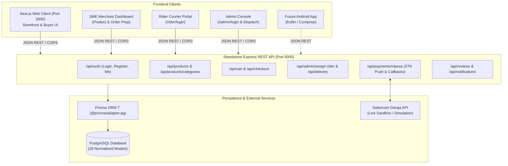

# SokoLink — Multi-Vendor Kenyan SME E-commerce Platform

[](file:///home/wiseman/Desktop/sokolink/frontend)
[](file:///home/wiseman/Desktop/sokolink/backend)
[](https://www.postgresql.org/)
[](https://developer.safaricom.co.ke/)
[](file:///home/wiseman/Desktop/sokolink/backend/scripts/test-workflows.ts)

SokoLink is a production-oriented, multi-vendor e-commerce platform engineered specifically for the Kenyan digital economy. It connects Kenyan Small and Medium Enterprises (SMEs) with local customers and urban courier networks, featuring direct **Safaricom M-Pesa Daraja mobile payments**, **multi-vendor checkout with seller-specific fulfillment groups**, **6-digit proof-of-delivery OTP verification**, and **administrator courier dispatch & assignment**.

The project is built with a **clean separation between Frontend and Backend**:
- **`backend/`**: Standalone Express.js + TypeScript + Prisma REST API server running on port `5000`.
- **`frontend/`**: Standalone Next.js 16 (React 19 + Tailwind CSS) client running on port `3000`.

---

## 📑 Table of Contents

- [1. System Architecture](#1-system-architecture)
- [2. User Roles & Dedicated Access Control](#2-user-roles--dedicated-access-control)
- [3. Key Architectural Innovations](#3-key-architectural-innovations)
- [4. Project Structure (Frontend & Backend Separated)](#4-project-structure-frontend--backend-separated)
- [5. PostgreSQL Database Schema (28 Models)](#5-postgresql-database-schema-28-models)
- [6. Complete REST API Reference](#6-complete-rest-api-reference)
- [7. Complete Frontend Page Map](#7-complete-frontend-page-map)
- [8. Demo Accounts & Credentials](#8-demo-accounts--credentials)
- [9. Quick Start Guide](#9-quick-start-guide)
- [10. Automated Verification & Testing](#10-automated-verification--testing)
- [11. Companion Android App Readiness](#11-companion-android-app-readiness)

---

## 1. System Architecture



---

## 2. User Roles & Dedicated Access Control

SokoLink enforces role-based access control at the server boundary using signed HTTP-only JWT sessions and bearer tokens.

| Role | Target Users | Portal / Login Route | Capabilities |
|---|---|---|---|
| **CUSTOMER** | Everyday Kenyan Shoppers | `/login` & `/register` | Browse catalogue, filter by Kenyan county/category, multi-vendor cart, M-Pesa STK checkout, live milestone tracking with 6-digit OTP code, review products. |
| **SME** | Kenyan Businesses & Artisans | `/login` (with SME account) & `/register?role=sme` | Business onboarding (BN/PIN), catalog listing, multiple product images, stock adjustments, low-stock warnings, order fulfillment readiness. |
| **DELIVERY** | Motorbike & Van Couriers | **Direct:** `/rider/login` (unlisted) | View assigned tasks, view merchant pickup & customer dropoff directions, phone customer, transit updates, and **6-digit OTP proof-of-delivery**. |
| **ADMIN** | SokoLink Platform Operators | **Direct:** `/admin/login` (unlisted) | Gross Merchandise Value (GMV), 5% net platform revenue, SME onboarding moderation (Approve/Reject/Suspend), **Courier Dispatch & Rider Assignment**, and Audit Logs. |

> [!IMPORTANT]
> **Strict Role Boundary Design:** Public storefront navigation bars and footers are strictly streamlined for Customers and SME merchants. The Admin Console (`/admin/login`) and Rider Dispatch Portal (`/rider/login`) operate on dedicated, unlisted routes and are never displayed on public headers or footers.

---

## 3. Key Architectural Innovations

### A. Multi-Vendor Atomic Checkout
When a customer purchases items from multiple SMEs in a single cart:
1. Prices and availability are re-queried directly from PostgreSQL (browser client prices are never trusted).
2. The transaction provisions a parent `Order` alongside seller-specific `SellerOrder` fulfillment groups.
3. Inventory is decremented atomically with an `InventoryMovement` entry (`ORDER_RESERVATION`) preventing overselling and negative inventory.
4. Tiered courier fees are calculated: base fee of KES 250 plus KES 100 per additional merchant pickup depot.

### B. Safaricom M-Pesa Daraja Integration
- Formats standard Kenyan MSISDNs (`07...`, `01...`, `+254...` &rarr; `2547...`).
- Implements OAuth 2.0 token generation and base64 encrypted timestamp passwords (`shortcode + passkey + timestamp`).
- Issues STK Push prompts to customer handsets.
- Full idempotent callback processor (`/api/payments/mpesa/callback`) matching checkout request IDs and expected amounts before marking orders `PAID`.
- Safe sandbox mock simulation fallback mode for local development.

### C. Proof-of-Delivery OTP Verification
- To prevent courier disputes and protect buyers, every order generates an unguessable 6-digit code.
- Displayed exclusively on the buyer's live tracking timeline (`/track/[token]`).
- The courier cannot mark an order `DELIVERED` without inputting this code, guaranteeing physical package inspection before escrow fund release.

### D. Seller-Driven Courier Dispatch & Automated Buyer SMS
- Rather than waiting for a central administrator, **merchants assign couriers directly from their SME Dashboard** once items are boxed and ready.
- Merchants can browse active licensed Kenyan couriers, compare vehicle types (Motorbike, Bicycle, Van) and customer ratings.
- Upon dispatch confirmation, the system updates the order to `READY_FOR_PICKUP` and immediately triggers an **automated transactional SMS alert** to the buyer containing the courier's full name, motorcycle number plate (e.g., `KMDF 452X`), mobile contact, and real-time GPS tracking link.

### E. Admin Courier Fleet Management (Add & Remove Riders)
- Super Administrators can onboard new licensed couriers through the dedicated **Couriers & Fleet** console in `/admin/dashboard`.
- Supports full rider profile setup: Full Name, Kenyan Phone (`+254...`), Email, Vehicle Type & Plate Number, and National ID Number.
- Admins can immediately deactivate and remove non-compliant couriers with a single click, taking their profile offline and suspending access.

### F. Homepage 1-Click Quick Checkout Modal
- Buyers browsing the homepage can click **"Buy Now"** on any featured product to launch the Quick Checkout modal without navigating through a multi-step funnel.
- Prompts for complete Kenyan drop-off logistics (County, Sub-County/Town, Estate/Street/House number, landmark, and rider notes).
- Calculates real-time delivery fees, offers quantity adjustments, and initiates Safaricom M-Pesa STK push prompts with automatic redirect to the live parcel tracking timeline.

---

## 4. Project Structure (Frontend & Backend Separated)

```
sokolink/
├── backend/                        # STANDALONE REST API SERVER (Port 5000)
│   ├── prisma/
│   │   ├── schema.prisma           # 28 PostgreSQL models
│   │   └── seed.ts                 # Realistic Kenyan SMEs, couriers & catalog
│   ├── src/
│   │   ├── server.ts               # Express.js application entry point
│   │   ├── middleware/
│   │   │   └── auth.ts             # JWT Bearer token & cookie parser + Role RBAC
│   │   ├── routes/
│   │   │   ├── auth.routes.ts      # /api/auth (login, register, me, logout)
│   │   │   ├── products.routes.ts  # /api/products, /api/products/categories
│   │   │   ├── cart.routes.ts      # /api/cart (get, add, remove)
│   │   │   ├── checkout.routes.ts  # /api/checkout (atomic multi-vendor checkout)
│   │   │   ├── orders.routes.ts    # /api/orders, /api/orders/track/:token
│   │   │   ├── delivery.routes.ts  # /api/delivery (rider tasks & OTP verification)
│   │   │   ├── sme.routes.ts       # /api/sme/products, /api/sme/orders
│   │   │   ├── admin.routes.ts     # /api/admin/assign-rider, /api/admin/smes, stats
│   │   │   ├── payments.routes.ts  # /api/payments/mpesa (STK push & callbacks)
│   │   │   ├── reviews.routes.ts   # /api/reviews
│   │   │   └── notifications.routes.ts
│   │   └── lib/
│   │       ├── prisma.ts           # PrismaPg connection pool
│   │       ├── auth.ts             # Bcrypt hashing & Jose JWT signing
│   │       ├── mpesa.ts            # Daraja STK push helpers & callback parser
│   │       └── utils.ts
│   ├── scripts/
│   │   └── test-workflows.ts       # 28 automated database & business tests
│   ├── package.json
│   ├── tsconfig.json
│   └── .env
│
├── frontend/                       # STANDALONE NEXT.JS CLIENT (Port 3000)
│   ├── src/
│   │   ├── app/
│   │   │   ├── page.tsx            # Storefront homepage
│   │   │   ├── products/           # Catalogue browser & [slug] product details
│   │   │   ├── sellers/[slug]/     # SME merchant storefronts
│   │   │   ├── cart/               # Multi-vendor cart
│   │   │   ├── checkout/           # Checkout & M-Pesa trigger
│   │   │   ├── track/[token]/      # Live milestone tracking & 6-digit OTP
│   │   │   ├── login/ & register/  # Customer & SME onboarding
│   │   │   ├── customer/dashboard/ # Customer order history & addresses
│   │   │   ├── sme/dashboard/      # SME inventory & order prep
│   │   │   ├── admin/login/        # Unlisted Admin sign-in
│   │   │   ├── admin/dashboard/    # GMV, SME approvals, & Rider Assignment Modal
│   │   │   ├── rider/login/        # Unlisted Rider sign-in
│   │   │   └── delivery/dashboard/ # Rider task list & OTP handover verification
│   │   ├── components/             # Reusable UI components (Navbar, Footer, etc.)
│   │   ├── context/                # Cart & Auth React contexts
│   │   └── types/                  # TypeScript interface definitions
│   ├── public/
│   ├── package.json
│   ├── tsconfig.json
│   ├── next.config.ts
│   └── .env.local                  # Points to NEXT_PUBLIC_API_URL=http://localhost:5000/api
│
├── README.md                       # Complete Project Documentation
└── package.json                    # Root workspace manager
```

---

## 5. PostgreSQL Database Schema (28 Models)

```
User (id, email, passwordHash, role, status, phone)
├── CustomerProfile (userId, defaultAddressId)
├── SMEProfile (userId, businessName, businessSlug, category, taxPin, status, commissionRate, rating)
│   ├── Product (smeId, categoryId, name, slug, sku, price, stock, condition, rating)
│   │   ├── ProductImage (productId, url, isPrimary)
│   │   ├── InventoryMovement (productId, changeType, quantityChange, previousStock, newStock)
│   │   ├── CartItem (cartId, productId, quantity)
│   │   ├── WishlistItem (userId, productId)
│   │   ├── OrderItem (orderId, sellerOrderId, productId, quantity, price, subtotal)
│   │   └── Review (productId, smeId, customerId, rating, comment)
│   ├── SellerOrder (orderId, smeId, subtotal, deliveryFee, status)
│   │   └── Delivery (deliveryReference, sellerOrderId, deliveryPersonId, pickupAddress, dropoffAddress, status, verificationCode)
│   │       └── DeliveryStatusHistory (deliveryId, previousStatus, newStatus, changedByUserId)
│   └── SellerPayout (smeId, amount, periodStart, status)
├── DeliveryProfile (userId, vehicleType, vehiclePlate, idNumber, status, isApproved, completedOrders)
├── Address (userId, recipientName, phone, county, subCounty, estateOrStreet, landmark)
├── Order (orderNumber, customerId, subtotal, deliveryFee, totalAmount, paymentStatus, fulfillmentStatus, trackingToken, deliveryVerificationCode)
│   ├── OrderStatusHistory (orderId, previousStatus, newStatus, comment)
│   ├── Payment (orderId, paymentReference, provider, status, mpesaReceiptNumber, checkoutRequestId)
│   │   └── PaymentEvent (paymentId, eventType, providerRef, payload)
│   └── Refund (orderId, amount, reason, status)
├── Category (name, slug, icon, parentId)
├── Cart (userId, guestToken)
├── Coupon & CouponRedemption (code, discountType, discountValue, usageCount)
├── Notification (userId, title, message, type, isRead)
├── SupportTicket (ticketNumber, userId, subject, priority, status)
└── AuditLog (userId, action, entityType, entityId, details)
```

---

## 6. Complete REST API Reference

The backend API server operates on `http://localhost:5000`.

### Authentication & Profiles
- `POST /api/auth/login` — Login with email & password (returns user and JWT token; sets session cookie)
- `POST /api/auth/register` — Register customer, SME merchant, or delivery courier
- `GET /api/auth/me` — Retrieve current authenticated session
- `POST /api/auth/logout` — Clear session

### Catalogue & Inventory
- `GET /api/products` — List filterable products (`?search=`, `?category=`, `?seller=`, `?minPrice=`, `?maxPrice=`, `?sort=`, `?page=`, `?limit=`)
- `GET /api/products/categories` — List all product categories with active product counts
- `GET /api/products/:slug` — Product detail with image gallery and reviews

### Cart & Multi-Vendor Checkout
- `GET /api/cart` — Retrieve shopping cart for user or guest
- `POST /api/cart` — Add or update item quantity in cart
- `DELETE /api/cart` — Remove item or clear cart
- `POST /api/checkout` — Multi-vendor atomic checkout: deducts inventory, creates parent Order + child SellerOrders, assigns available couriers, generates 6-digit delivery OTP code

### Orders & Tracking
- `GET /api/orders` — Customer order history (requires CUSTOMER or ADMIN role)
- `GET /api/orders/track/:token` — Public order milestone timeline, delivery status, and verification OTP code

### Admin Console & Rider Assignment
- `POST /api/admin/assign-rider` — Assign or reassign a package/delivery to a specific verified courier (requires ADMIN role)
- `GET /api/admin/smes` — List all registered SMEs with moderation statuses (requires ADMIN role)
- `PATCH /api/admin/smes` — Approve, reject, or suspend SME accounts (requires ADMIN role)
- `GET /api/admin/riders` — List all verified delivery couriers (requires ADMIN role)
- `GET /api/admin/orders` — Platform-wide orders overview (requires ADMIN role)
- `GET /api/admin/stats` — High-level platform GMV and revenue metrics (requires ADMIN role)

### Courier & Delivery Management
- `GET /api/delivery` — List assigned delivery jobs (requires DELIVERY or ADMIN role)
- `PATCH /api/delivery` — Update delivery status (`ACCEPTED` &rarr; `PICKED_UP` &rarr; `IN_TRANSIT` &rarr; `DELIVERED`). Requires valid 6-digit verification OTP code when marking `DELIVERED`.

### SME Merchant Management
- `GET /api/sme/products` — List merchant products (requires SME or ADMIN role)
- `POST /api/sme/products` — Create new product with stock and images (requires SME role)
- `GET /api/sme/orders` — List merchant suborders (requires SME or ADMIN role)
- `PATCH /api/sme/orders` — Update fulfillment readiness status (requires SME or ADMIN role)

### Payments & Daraja
- `POST /api/payments/mpesa/stkpush` — Trigger Safaricom M-Pesa STK push
- `POST /api/payments/mpesa/callback` — Idempotent webhook callback receiver

### Reviews & Notifications
- `POST /api/reviews` — Submit verified product review and update merchant rating
- `GET /api/notifications` — Retrieve user notifications
- `PATCH /api/notifications` — Mark notification(s) as read

---

## 7. Complete Frontend Page Map

The frontend operates on `http://localhost:3000`.

### Public Storefront
- `/` — Homepage (Hero banner, category carousel, featured products, recommended SMEs, trust badges)
- `/products` — Filterable catalogue (category, price range, keyword search, sorting, pagination)
- `/products/[slug]` — Product details with image gallery, seller verification badge, and Add to Cart
- `/sellers/[slug]` — SME merchant storefront displaying vendor profile and items
- `/cart` — Multi-vendor cart grouped by merchant with coupon box (`KARIBU10`, `SOKO500`)
- `/checkout` — Checkout with Kenyan address forms, delivery speeds, and M-Pesa STK trigger
- `/track/[token]` — Live order milestone timeline & **6-digit delivery verification OTP code**
- `/help` — FAQs, M-Pesa guide, SME policy, and customer care
- `/terms` & `/privacy` — Terms of service & Kenya Data Protection Act 2019 compliance

### Dedicated Portals & Dashboards
- `/login` — Customer and SME sign-in
- `/register` — Customer registration & SME business onboarding
- `/customer/dashboard` — Customer orders, order tracking links, and delivery addresses
- `/sme/dashboard` — SME merchant analytics, listed products, stock alerts, and Add Product modal
- `/admin/login` — Direct unlisted administration login
- `/admin/dashboard` — GMV analytics, 5% revenue, SME moderation, and **Rider Assignment Console**
- `/rider/login` & `/delivery/login` — Direct unlisted courier dispatch sign-in
- `/delivery/dashboard` — Assigned courier tasks, routing instructions, and **OTP Verification Modal**

---

## 8. Demo Accounts & Credentials

The PostgreSQL database comes pre-seeded with realistic Kenyan SME data, products, orders, and demo accounts:

| Role | Email Address | Password | Account Details |
|---|---|---|---|
| **ADMIN** | `admin@sokolink.co.ke` | `Admin@2026!` | Super Administrator (Full platform governance & rider assignment) |
| **SME 1** | `kazi@nairobielectronics.co.ke` | `Sme@2026!` | Nairobi Electronics Hub (Luthuli Ave, CBD) |
| **SME 2** | `sales@maasaicrafts.co.ke` | `Sme@2026!` | Maasai Artisans Collective (Westlands) |
| **SME 3** | `mama@kilimogreen.co.ke` | `Sme@2026!` | Kilimo Fresh Farm Produce (Limuru Road) |
| **SME 4** | `pending@savannahgoods.co.ke` | `Sme@2026!` | Savannah Natural Honey (Pending Admin Approval) |
| **DELIVERY** | `rider@sokolink.co.ke` | `Rider@2026!` | Juma Ochieng (Boxed Motorbike KMDF 452X) |
| **CUSTOMER** | `wambui.kamau@gmail.com` | `Customer@2026!` | Wambui Kamau (Kilimani, Nairobi) |

---

## 9. Quick Start Guide

### 1. Database Setup & Seeding
From the `backend/` directory:
```bash
cd /home/wiseman/Desktop/sokolink/backend

# Synchronize database schema
npx prisma db push

# Populate initial seed data
npm run seed
```

### 2. Start the Backend API Server (Port 5000)
```bash
cd /home/wiseman/Desktop/sokolink/backend
npm run dev
```
Health check: [http://localhost:5000/api/health](http://localhost:5000/api/health)

### 3. Start the Frontend Client (Port 3000)
In a separate terminal:
```bash
cd /home/wiseman/Desktop/sokolink/frontend
npm run dev
```
Open [http://localhost:3000](http://localhost:3000) in your browser.

### 4. Or Run from Root
```bash
cd /home/wiseman/Desktop/sokolink
npm run dev:backend    # Runs backend on port 5000
npm run dev:frontend   # Runs frontend on port 3000
```

---

## 10. Automated Verification & Testing

Run the automated test suite verifying critical business workflows against the live database:

```bash
cd /home/wiseman/Desktop/sokolink/backend
npm run test:workflows
```

### Verified Test Suites (28 Tests Passing):
1. **Security & Authentication:** Bcrypt password hashing, mismatch rejections, Jose JWT claims encoding/decoding.
2. **Role-Based Access:** ADMIN, SME, DELIVERY, and CUSTOMER profile relations.
3. **SME Moderation:** Approval workflow and state transitions.
4. **Multi-Vendor Order Consistency:** Inventory check, atomic reservation, and stock deduction.
5. **Admin Courier Assignment:** Real database task assignment, notification generation, and audit logging.
6. **M-Pesa Daraja Helpers:** Kenyan MSISDN sanitization, timestamp formatting, encrypted passwords, STK push initiation, and Safaricom callback parsing.
7. **Payment & Order Lifecycle:** Order transition from `PENDING_PAYMENT` &rarr; `PAID` &rarr; `CONFIRMED`.
8. **Proof-of-Delivery Handover:** Correct OTP code verification and rejection of invalid codes.

### Build Verification
- **Backend:** `cd backend && npm run build` (TypeScript compilation clean)
- **Frontend:** `cd frontend && npm run build` (All 36 pages and routes compiled cleanly with 0 errors)

---

## 11. Companion Android App Readiness

The backend has been designed with RESTful, JSON-first API conventions to directly support a companion native Android application (Kotlin / Jetpack Compose):

```
┌─────────────────────────────────┐
│     SokoLink Android App        │
│   (Customers / Couriers / SMEs) │
└───────────────┬─────────────────┘
                │ Retrofit / OkHttp
                ▼
┌─────────────────────────────────┐
│   Express REST API Backend      │
│     (http://<host>:5000/api)    │
└───────────────┬─────────────────┘
                │ Prisma ORM
                ▼
┌─────────────────────────────────┐
│       PostgreSQL Database       │
└─────────────────────────────────┘
```

The Android app will connect directly to the Express REST API endpoints (`/api/auth`, `/api/delivery`, `/api/products`, `/api/payments/mpesa/stkpush`, etc.).

Development of the Android app is queued and will proceed upon user signal.

---

## 12. Recommended Production-Grade Feature Roadmap

Based on enterprise Kenyan e-commerce operations, here are recommended enhancements ready for implementation:

1. **Automated M-Pesa B2C Escrow Payouts:**
   - When the customer provides their 6-digit OTP code to the rider at the doorstep, the backend can automatically trigger a Safaricom Daraja B2C payout releasing 95% of the item cost directly to the SME merchant's M-Pesa till/phone and 100% of the delivery fee to the courier's M-Pesa wallet.

2. **Direct WhatsApp & One-Tap Call Links for Couriers:**
   - Add a one-tap `https://wa.me/254...` button on the Rider Portal task card allowing couriers to immediately contact the buyer or merchant via WhatsApp without having to manually dial.

3. **Dynamic County-to-County Shipping Matrix:**
   - Tiered delivery pricing based on Kenyan zones:
     - *Zone 1 (Nairobi Metro):* KES 200–250 (Same day)
     - *Zone 2 (Satellite Counties — Kiambu, Machakos, Kajiado):* KES 350 (24 hrs)
     - *Zone 3 (Upcountry Hubs — Nakuru, Mombasa, Kisumu, Eldoret):* KES 500 (48 hrs parcel bus / express courier)

4. **Interactive Google Maps / Leaflet Location Pinning:**
   - Enable buyers to tap a "Use Current GPS Location" button or drop a pin on a map to capture precise coordinates (`latitude`, `longitude`) alongside text landmarks, eliminating urban navigation errors in unnumbered residential estates.

---

## 📄 License
Copyright © 2026 SokoLink Kenya Ltd. All rights reserved.
